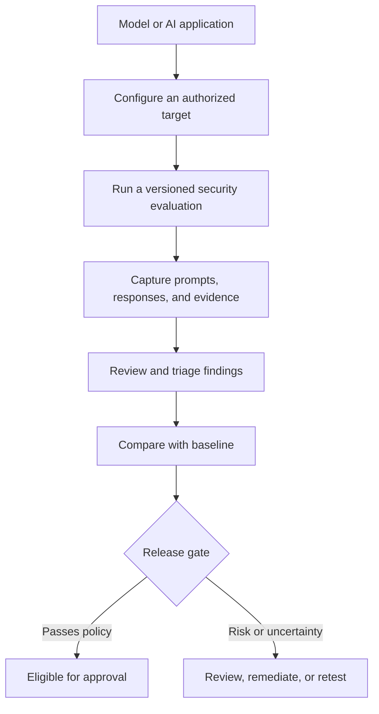

# AegisAI

**A practical security workbench for testing AI models, LLM applications, and agent workflows.**

AegisAI is a project I’m building to make AI security testing more repeatable and easier to investigate. Instead of relying on a few manual prompts, the goal is to run structured evaluations, preserve evidence, review findings, and make release decisions with a clearer audit trail.

> **Project status:** Actively developed. AegisAI includes local testing workflows and a growing set of security controls, with production deployment still subject to the documented release gates and security review. Do not expose an unreviewed instance to the public internet or use it with sensitive production data.

<p align="center">
  
  
  
  
  
</p>

## Why I’m building it

AI features are being added to products, internal tools, and automated workflows quickly. Traditional application security checks still matter, but they don’t fully answer questions about how an LLM behaves when it receives malicious instructions, untrusted retrieved content, or a risky tool-use request.

I’m building AegisAI to explore that gap hands-on: run repeatable tests, keep the evidence, let a human review the result, and make the decision process easier to explain.

## What it is designed to do

- **Evaluate model behavior** with repeatable test cases and security-focused evaluation suites.
- **Preserve investigation evidence** so results can be reviewed instead of reduced to a single score.
- **Support analyst workflows** for triage, ownership, review, and remediation tracking.
- **Compare results over time** and use baselines and release gates to identify regressions.
- **Add security checks around AI applications** including file inputs, RAG sources, and proposed agent actions.
- **Apply application security controls** such as authentication, organization-scoped data, MFA, scoped API tokens, and audit logging.
- **Run locally first** with a Docker Compose development environment and local model integrations.

These capabilities are being developed and hardened over time. Availability and maturity vary by feature; use the linked documentation and the current code as the source of truth.

## How the workflow fits together



AegisAI supports decision-making; it does not replace security review or guarantee that a model is safe.

## Security areas

The project focuses on practical risks in LLM-powered systems, including:

| Area | Example question |
| --- | --- |
| Prompt injection and jailbreaks | Can untrusted instructions override the intended policy? |
| Sensitive information exposure | Does the model reveal data it should not disclose? |
| Evaluation integrity | Can results be reproduced and compared against an approved baseline? |
| File and multimodal inputs | Can a risky upload be inspected before it reaches downstream components? |
| RAG source security | Does a knowledge source contain suspicious indirect instructions? |
| Agent and tool-use safety | Should a proposed action be allowed, reviewed, or denied? |
| Identity and access | Are users, permissions, tokens, and administrative actions controlled and audited? |
| Release readiness | Do the current findings meet the configured release policy? |

Coverage depends on the configured suite, provider, and runner. A passing evaluation is evidence for the tested cases—not proof that every attack or failure mode has been eliminated.

## Technology

- **Backend:** Python, FastAPI, Pydantic, SQLAlchemy
- **Data and services:** PostgreSQL, Redis, Alembic migrations
- **Frontend:** React, TypeScript, Vite
- **Model and evaluation integrations:** Ollama, Promptfoo, and compatible model endpoints where configured
- **Runtime:** Docker Compose
- **Quality and automation:** pytest, Ruff, and GitHub Actions

## Getting started

AegisAI is primarily developed as a local lab. The exact required environment variables and available services are defined in the repository's example configuration and deployment documentation.

### Prerequisites

- Git
- Docker Desktop with WSL 2 integration (or Docker Engine and Compose)
- A local model runtime such as Ollama if you want to test local models

### Start the local environment

```bash
git clone https://github.com/Parakh-Shinde/aegisai.git
cd aegisai
cp .env.example .env
```

Review `.env.example` and the [Docker guide](docs/docker.md) before starting. Set the required local values; do not reuse production credentials or commit your real `.env` file.

Then start the services using the repository's Makefile:

```bash
make start
```

When the services are healthy, the development dashboard is normally available at `http://127.0.0.1:5173` and the API at `http://127.0.0.1:8000`, as configured by the local Compose setup.

For setup details, health checks, cleanup, model connectivity, and troubleshooting, see [docs/docker.md](docs/docker.md) and [docs/start-lab.md](docs/start-lab.md).

## Security and deployment notes

Security is part of the project, not a claim that the project is already production-certified.

- Use only models, applications, and environments you own or are explicitly authorized to test.
- Keep credentials in environment variables or an appropriate secret manager; never commit real tokens, keys, passwords, or production environment files.
- Keep local services bound to loopback unless you have deliberately configured and reviewed network access.
- Review the [security deployment checklist](docs/security-deployment-checklist.md) and [production deployment guide](docs/production-deployment.md) before considering any non-local deployment.
- The production blueprint is not a substitute for validating secrets, backups and restores, monitoring, access controls, network exposure, and release checks in the actual environment.

## Documentation

The `docs/` directory contains implementation notes and guides for the project's security workflows. Useful starting points include:

- [Start the lab](docs/start-lab.md)
- [Docker setup](docs/docker.md)
- [Security deployment checklist](docs/security-deployment-checklist.md)
- [Production deployment](docs/production-deployment.md)
- [Evaluation integrity](docs/evaluation-integrity.md)
- [Identity operations](docs/identity-operations.md)
- [MFA and scoped API tokens](docs/mfa-api-tokens.md)
- [Agent runtime enforcement](docs/agent-runtime-enforcement.md)
- [Promptfoo tool runner](docs/promptfoo-tool-runner.md)
- [Security roadmap](docs/security-roadmap.md)

If a guide and the current code differ, treat the current code and verified behavior as authoritative and open an issue for anything that needs correction.

## Development approach

I’m building this incrementally: implement a security control, keep the behavior testable, document its limitations, and improve the workflow based on what the tests and hands-on use reveal. I’m especially interested in the intersection of AI security, application security, adversarial testing, and secure engineering.

Contributions, bug reports, and specific improvement suggestions are welcome. Please avoid posting live credentials, private customer data, or details of systems you do not have permission to test.

## Roadmap

Areas I’m continuing to improve include:

- Broader and more reliable adversarial evaluation coverage
- Stronger regression and release-gate evidence
- Safer integrations for AI agents, RAG, and multimodal inputs
- Clearer reports that help analysts reproduce and triage findings
- Continued review of authentication, tenant isolation, and production hardening
- Better setup documentation and developer experience

The roadmap is a work in progress; it should not be read as a claim that every item is complete.

## Author

**Parakh Shinde** — cybersecurity fresher building hands-on projects in AI security and security engineering.

- GitHub: [@Parakh-Shinde](https://github.com/Parakh-Shinde)
- Portfolio: [parakh-shinde.github.io](https://parakh-shinde.github.io/)

---

*Built as a hands-on learning and engineering project. Feedback that is specific, respectful, and reproducible is always useful.*
